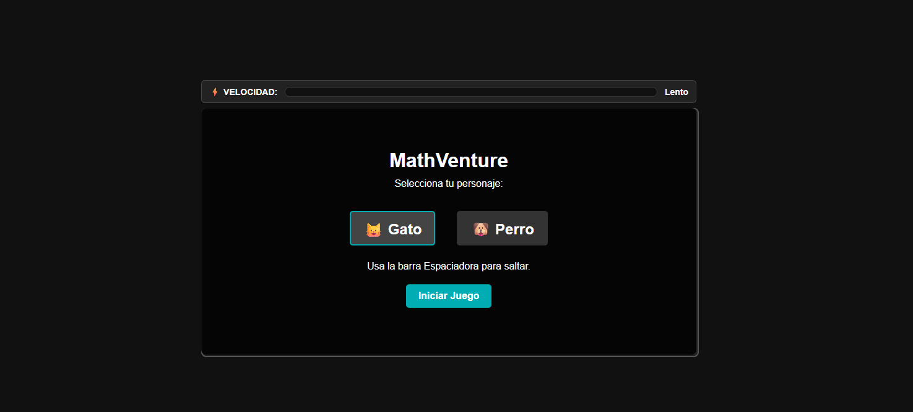
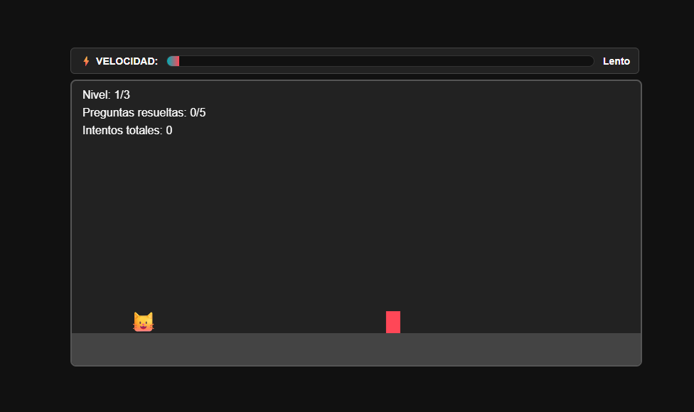
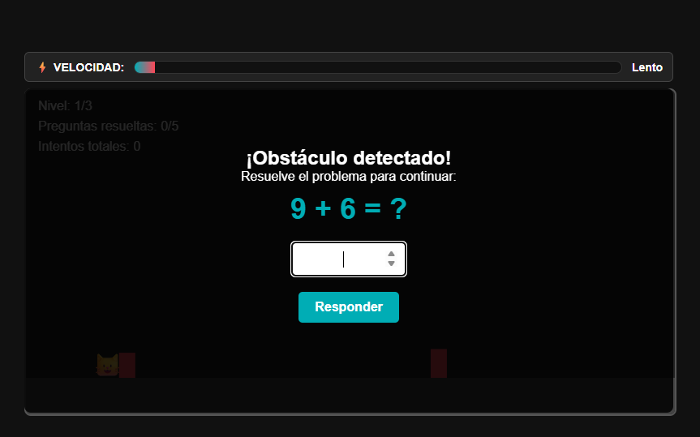
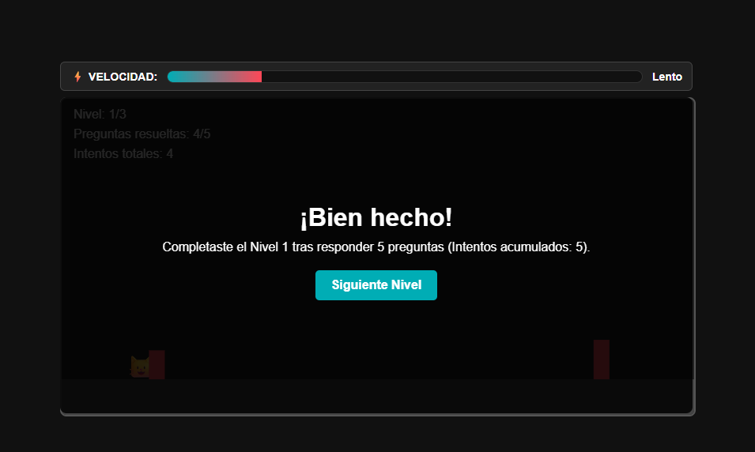

# 🧮 mathAdventure

[⬅ Volver al portafolio](../README.md)

## Descripción

**mathAdventure** es un juego de velocidad constante inspirado en *Geometry Dash*, donde el ritmo aumenta progresivamente a medida que avanzas. En lugar de simplemente esquivar obstáculos, cada choque te presenta una **operación matemática** (suma, resta, multiplicación o división) que debes resolver rápidamente.

- **¿De qué trata?** Un recorrido a alta velocidad que combina reflejos con cálculo mental.
- **Objetivo del jugador:** Avanzar la mayor distancia posible manteniendo el puntaje, respondiendo correctamente las operaciones que aparecen al chocar con un obstáculo.
- **Mecánica principal:** Si respondes bien, continúas sin penalización; si te equivocas, pierdes puntos y, si el error es crítico, pierdes la partida.

## Género

`Arcade` · `Runner` · `Educativo`

## Controles

| Tecla | Acción |
|---|---|
| **CLICK** | Saltar / interactuar con obstáculo |
| **SPACE** | Saltar |

## Tecnologías utilizadas

- HTML5, CSS3 y JavaScript (vanilla). La lógica de generación de obstáculos, colisiones y las operaciones matemáticas se maneja con JavaScript puro, sin librerías externas.

## Capturas de pantalla

| Pantalla inicial | Gameplay | Pregunta matemática | Fin de partida |
|---|---|---|---|
|  |  |  |  |

## Apoyo de IA

Se usó apoyo de IA para redactar y estructurar esta documentación (README) y para diseñar el banner gráfico del juego. La lógica del juego (colisiones, velocidad progresiva, generación de operaciones matemáticas) fue programada por el estudiante.

## Aprendizajes y mejoras futuras

- **Aprendí:** A manejar el aumento progresivo de dificultad (velocidad) sin romper la jugabilidad, y a integrar lógica matemática dentro de un bucle de juego en tiempo real con JavaScript.
- **Mejoraría:** Agregar más tipos de operaciones según el nivel de dificultad, sonido de feedback al acertar/fallar, y un sistema de puntaje máximo guardado localmente.
