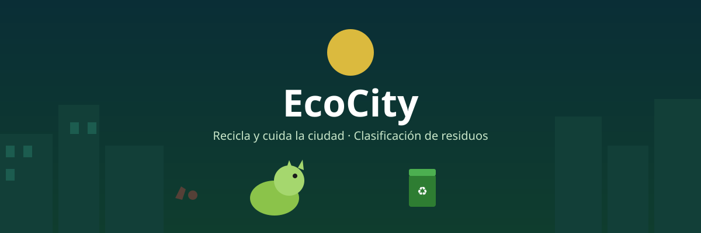
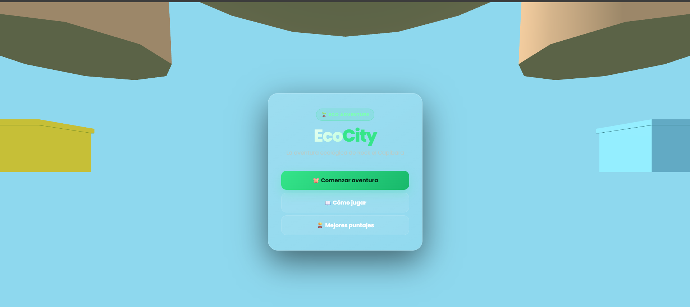
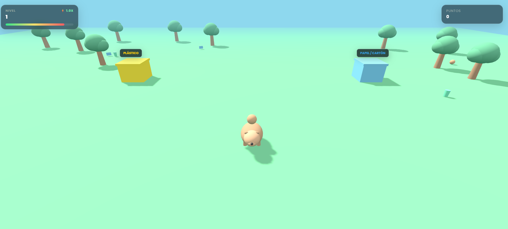
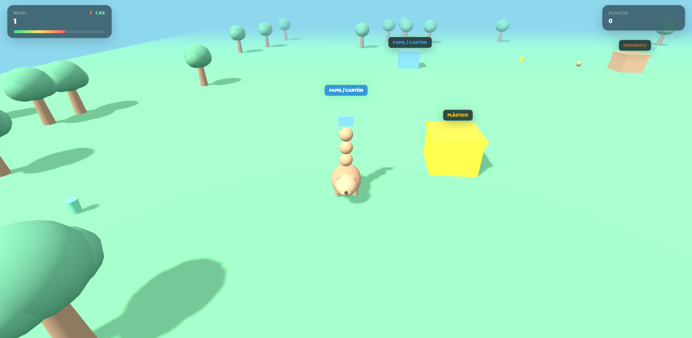

# ♻️ EcoCity

[⬅ Volver al portafolio](../README.md)

## Descripción

**EcoCity** sigue a un pequeño animal que recorre la ciudad recolectando basura y debe llevarla al contenedor correcto.

- **¿De qué trata?** Concientizar sobre el manejo correcto de los residuos a través del gameplay.
- **Objetivo del jugador:** Recolectar la mayor cantidad de basura posible y depositarla en el lugar correcto sin perder toda la vida.
- **Mecánica principal:** Si el jugador deposita la basura en el contenedor equivocado, pierde vida; si se queda sin vida, pierde la partida.

## Género

`Puzzle` · `Arcade` · `Educativo`

## Controles

| Tecla | Acción |
|---|---|
| **W** | Arriba |
| **A** | Izquierda |
| **S** | Abajo |
| **D** | Derecha |

## Tecnologías utilizadas

- HTML5, CSS3, JavaScript y Three.js (renderizado 3D del entorno de la ciudad).

## Capturas de pantalla

| Pantalla inicial | Gameplay | Recolectando basura | Fin de partida |
|---|---|---|---|
|  |  |  |  |

## Apoyo de IA

Se usó apoyo de IA para redactar y estructurar esta documentación (README) y para diseñar el banner gráfico del juego. La lógica del juego (recolección, clasificación de residuos y sistema de vida) fue programada por el estudiante.

## Aprendizajes y mejoras futuras

- **Aprendí:** A planificar la lógica de clasificación de residuos y el sistema de vida antes de programarlo, para tener clara la mecánica principal desde el diseño.
- **Mejoraría:** Agregar más tipos de residuos y contenedores, y niveles con distintos mapas de ciudad para variar la dificultad.
