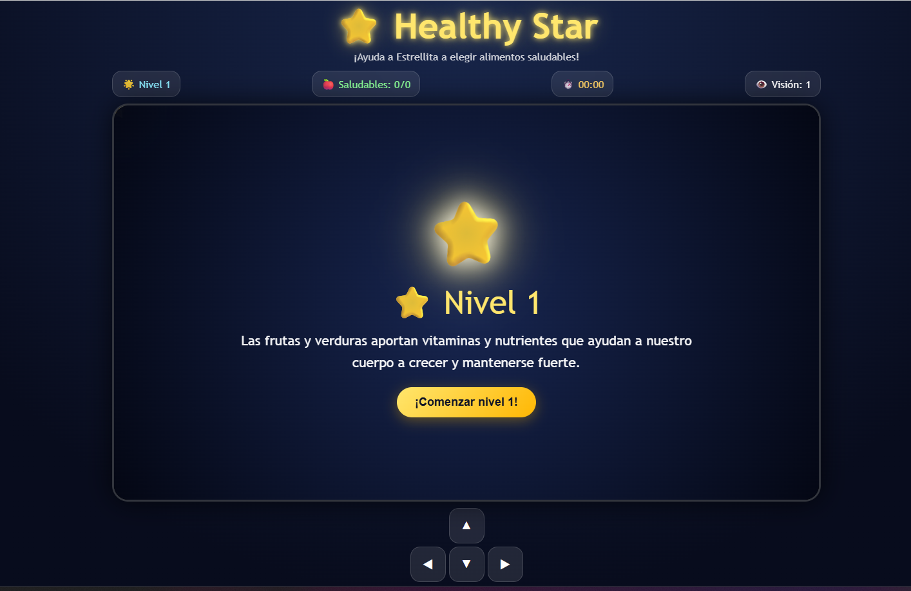
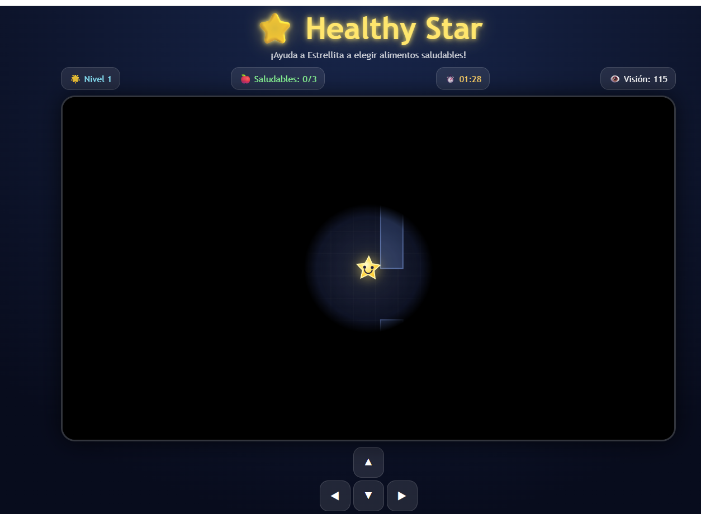
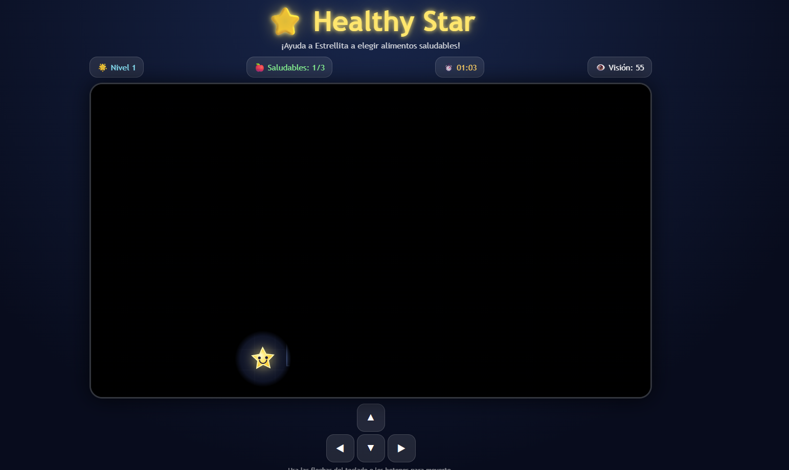
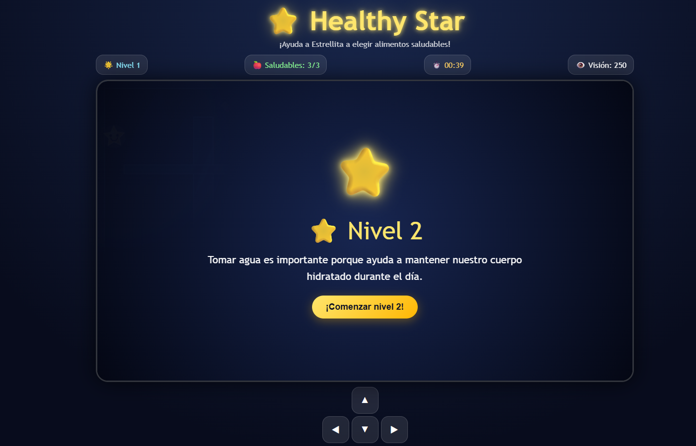

# ⭐ HealthyStar

[⬅ Volver al portafolio](../README.md)

## Descripción

**HealthyStar** pone al jugador en el papel de una estrella atrapada en un laberinto con visión muy limitada de su entorno.

- **¿De qué trata?** Un laberinto donde las decisiones alimenticias afectan directamente tu capacidad de ver y avanzar.
- **Objetivo del jugador:** Salir del laberinto antes de que se acabe el tiempo, eligiendo comida saludable en el camino.
- **Mecánica principal:** Comer saludable mejora la apariencia de la estrella y **amplía su campo de visión**; comer comida chatarra la oscurece y **reduce la visión**. Cada nivel incrementa la dificultad y reduce el margen de error.

## Género

`Puzzle` · `Survival` · `Educativo`

## Controles

| Tecla | Acción |
|---|---|
| **WASD** | Movimiento |

## Tecnologías utilizadas

- HTML5, CSS3 y JavaScript (vanilla). El campo de visión limitado y su variación según la alimentación del personaje se controla con JavaScript.

## Capturas de pantalla

| Pantalla inicial | Gameplay (buena visión) | Gameplay (visión reducida) | Victoria/derrota |
|---|---|---|---|
|  |  |  |  |

## Apoyo de IA

Se usó apoyo de IA para redactar y estructurar esta documentación (README) y para diseñar el banner gráfico del juego. La lógica del laberinto y el sistema de visión fue programada por el estudiante.

## Aprendizajes y mejoras futuras

- **Aprendí:** A manejar un campo de visión dinámico dentro de un laberinto y a balancear la dificultad progresiva entre niveles junto con un límite de tiempo.
- **Mejoraría:** Agregar más niveles, mayor variedad de alimentos saludables/chatarra, y un sistema de pistas para cuando el jugador se queda atascado.
