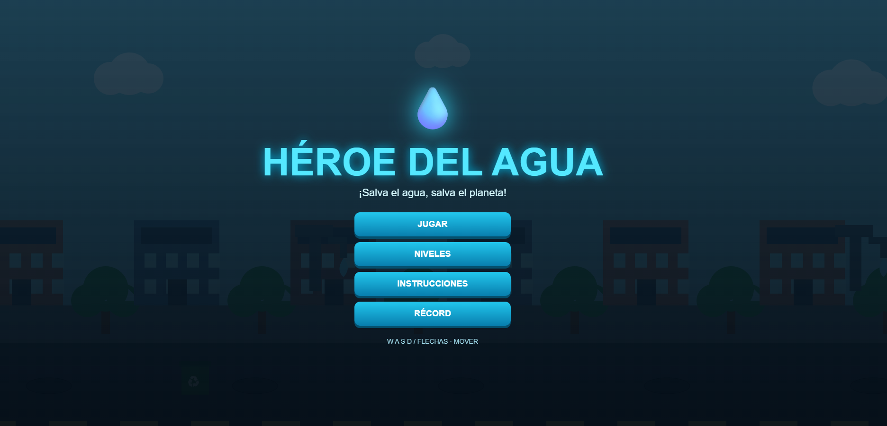
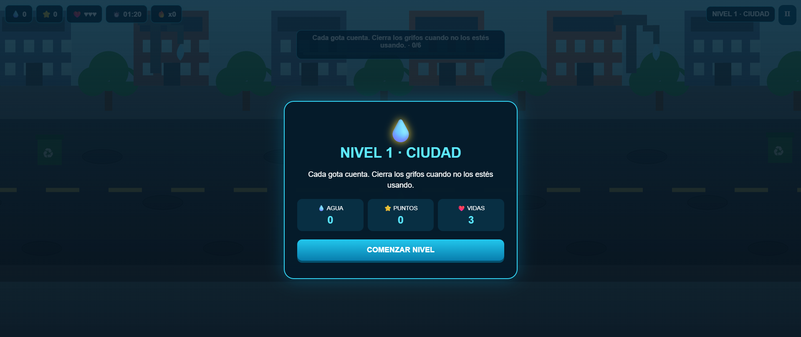
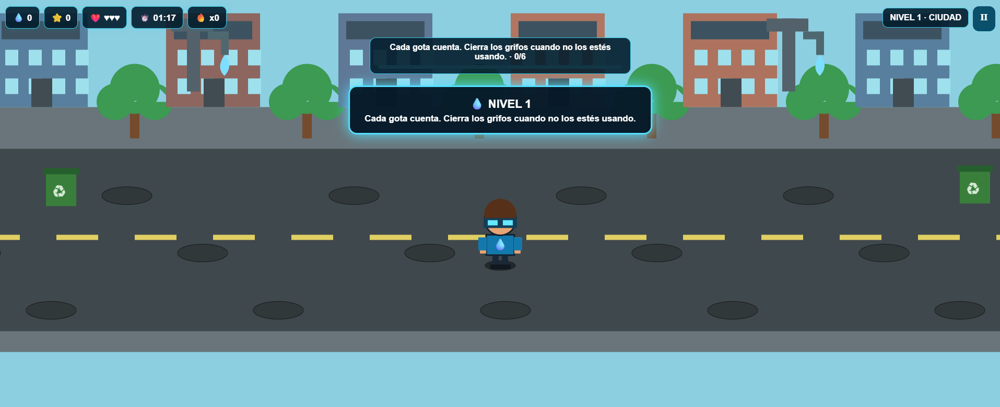
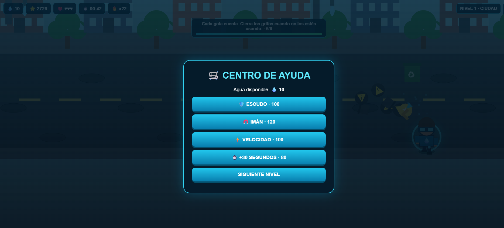

# 💧 Héroe del Agua

[⬅ Volver al portafolio](../README.md)

## Descripción

**Héroe del Agua** sigue a un chico que recorre la ciudad cerrando grifos abiertos para evitar el desperdicio de agua.

- **¿De qué trata?** Concientizar sobre el cuidado del agua a través de una mecánica de exploración y decisión rápida.
- **Objetivo del jugador:** Cerrar la mayor cantidad de grifos posible sin perder toda su vida.
- **Mecánica principal:** En el mapa aparecen íconos **"plus"** aleatorios que atraen los grifos cercanos (facilitando cerrarlos), pero también atraen basura dispersa por el mapa; tocar la basura resta puntos y vida.

## Género

`Arcade` · `Acción` · `Educativo`

## Controles

| Tecla | Acción |
|---|---|
| **W A S D** | Movimiento |

## Tecnologías utilizadas

- HTML5, CSS3 y JavaScript (vanilla), con la lógica del juego separada en game.js.

## Capturas de pantalla

| Pantalla inicial | Gameplay | Cerrando un grifo | Fin de partida |
|---|---|---|---|
|  |  |  |  |

## Apoyo de IA

Se usó apoyo de IA para redactar y estructurar esta documentación (README) y para diseñar el banner gráfico del juego. La lógica del juego (grifos, power-ups, basura, vida) fue programada por el estudiante.

## Aprendizajes y mejoras futuras

- **Aprendí:** A manejar múltiples elementos aleatorios en pantalla al mismo tiempo (grifos, power-ups y basura) y a equilibrar el riesgo/beneficio del power-up que atrae ambos tipos de objetos.
- **Mejoraría:** Agregar mapas más grandes, distintos tipos de power-ups, y niveles organizados por barrio con dificultad creciente.
