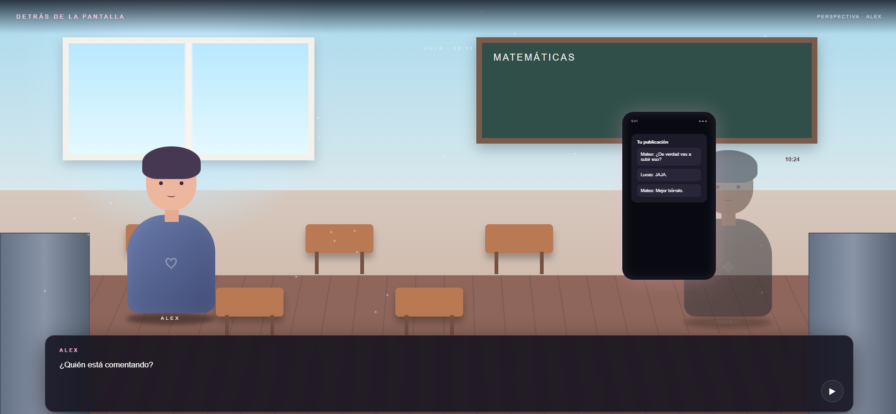
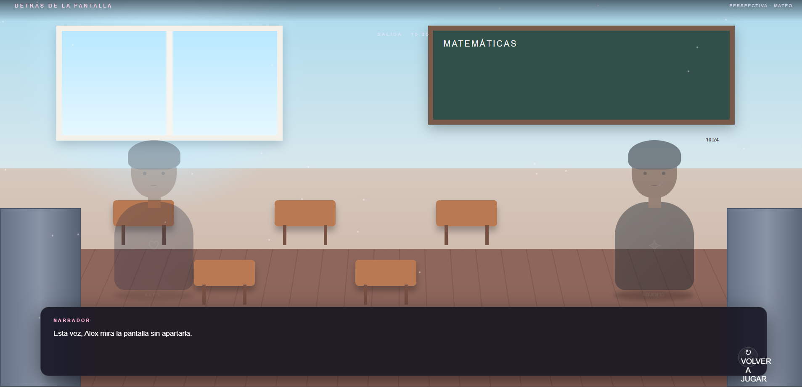
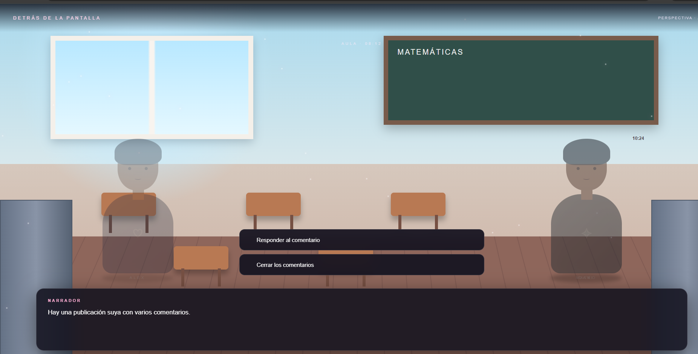
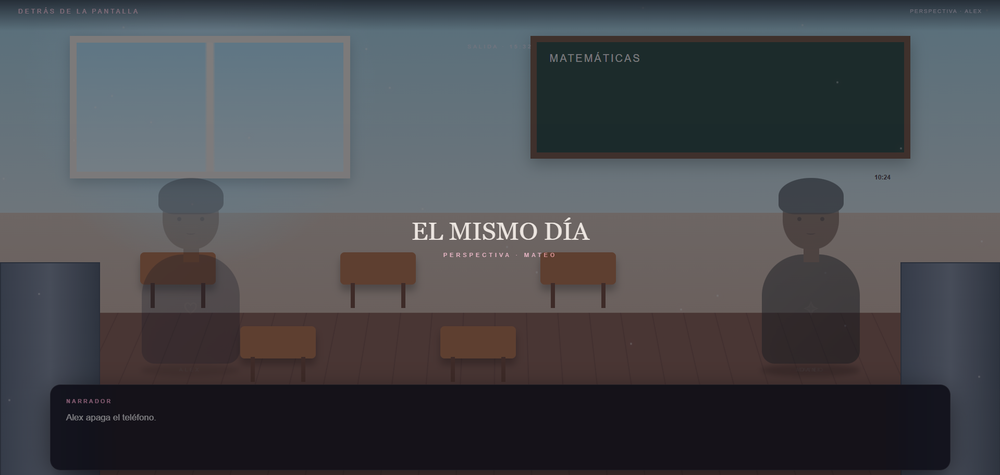

# 📱 Detrás de la Pantalla

[⬅ Volver al portafolio](../README.md)

## Descripción

**Detrás de la Pantalla** es una experiencia narrativa (*storytelling*) sobre un adolescente promedio que vive su rutina diaria: va a la escuela, sube fotos a redes sociales y, en cierto punto, recibe un mensaje de burla.

- **¿De qué trata?** Las consecuencias del ciberacoso, contadas desde **dos perspectivas jugables**: la del acosado y la del acosador.
- **Objetivo del jugador:** Explorar cómo las decisiones —responder o ignorar— cambian el desenlace de la historia desde cada perspectiva.
- **Mecánica principal:** El jugador toma decisiones narrativas ante el mensaje recibido; según la elección y la perspectiva, el juego muestra un mensaje final **"motivador"** o de **"advertencia"**.

## Género

`Narrativo` · `Storytelling` · `Concientización social`

## Controles

| Tecla / acción | Función |
|---|---|
| **CLICK** | Seleccionar opción de diálogo |

## Tecnologías utilizadas

- HTML5, CSS3 y JavaScript (vanilla), con la lógica narrativa y de decisiones manejada en script.js.

## Capturas de pantalla

| Rutina diaria | Mensaje recibido | Perspectiva acosado | Perspectiva acosador |
|---|---|---|---|
|  |  |  |  |

## Apoyo de IA

Se usó apoyo de IA para redactar y estructurar esta documentación (README) y para diseñar el banner gráfico del juego. El guion, los diálogos y las ramas de decisión fueron desarrollados por el estudiante.

## Aprendizajes y mejoras futuras

- **Aprendí:** A estructurar una narrativa con ramas de decisión y dos perspectivas distintas de un mismo evento, manteniendo coherencia en ambos finales.
- **Mejoraría:** Agregar más ramas de la historia, más personajes secundarios, y recursos de audio para reforzar el tono emocional de cada escena.
