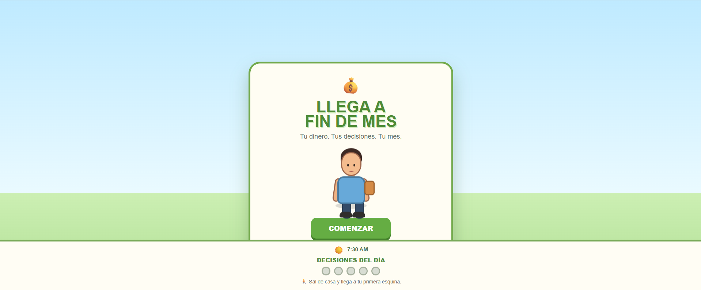
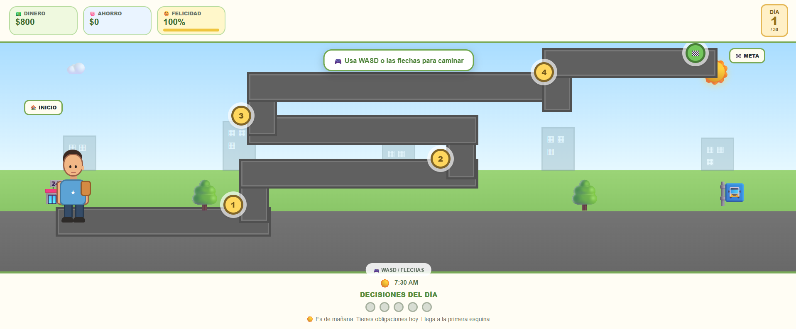
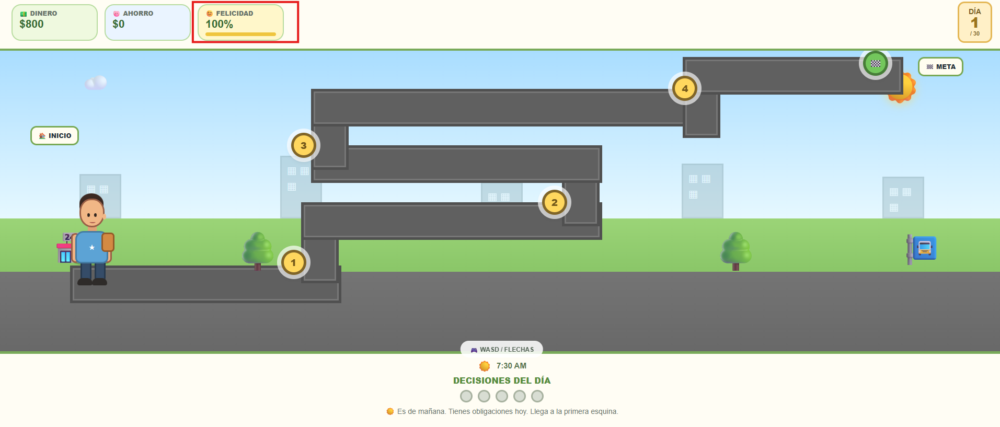
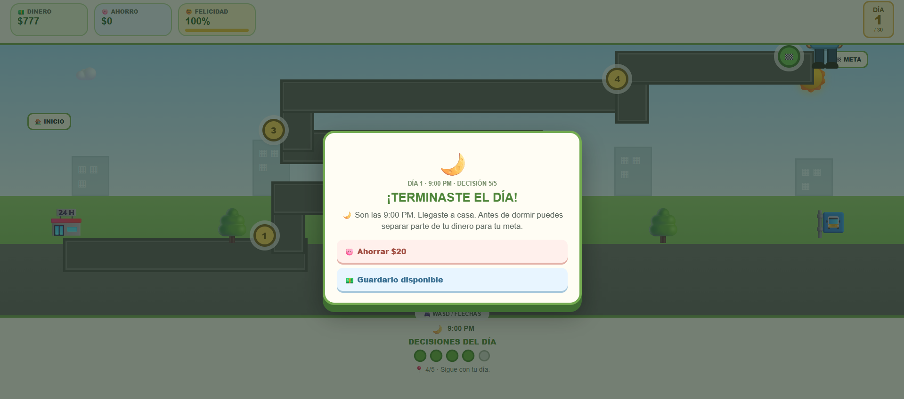

# 💰 Llega a Fin de Mes

[⬅ Volver al portafolio](../README.md)

## Descripción

**Llega a Fin de Mes** es un simulador de decisiones económicas donde el objetivo es sobrevivir financiera y emocionalmente hasta el final del mes.

- **¿De qué trata?** La gestión del dinero y el estado de ánimo frente a eventos cotidianos e imprevistos.
- **Objetivo del jugador:** Llegar a fin de mes manteniendo un balance económico positivo y un buen estado de ánimo.
- **Mecánica principal:** A lo largo del camino aparecen eventos aleatorios (salidas con amigos, compras) que consumen dinero; cada decisión afecta tanto el saldo disponible como el estado de ánimo del personaje, que sube o baja según cómo se gaste (o ahorre) el dinero.

## Género

`Simulación` · `Decisiones` · `Gestión de recursos`

## Controles

| Tecla / acción | Función |
|---|---|
| **CLICK** | Elegir una decisión / evento |

## Tecnologías utilizadas

- HTML5, CSS3 y JavaScript (vanilla), con la lógica de eventos y economía manejada en script.js.

## Capturas de pantalla

| Pantalla inicial | Evento económico | Estado de ánimo | Fin de mes |
|---|---|---|---|
|  |  |  |  |

## Apoyo de IA

Se usó apoyo de IA para redactar y estructurar esta documentación (README) y para diseñar el banner gráfico del juego. El sistema de eventos económicos y el balance del estado de ánimo fueron desarrollados por el estudiante.

## Aprendizajes y mejoras futuras

- **Aprendí:** A diseñar un sistema de eventos aleatorios que afecte dos variables a la vez (dinero y estado de ánimo) manteniendo el juego balanceado y justo.
- **Mejoraría:** Agregar más tipos de eventos, un gráfico de historial de gastos, y distintos finales según cómo termine el mes económicamente.
