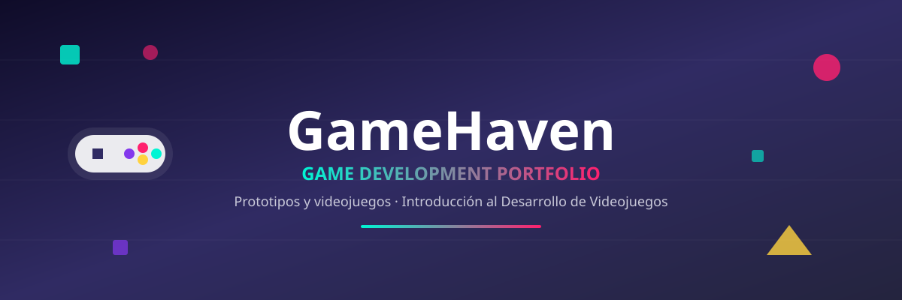
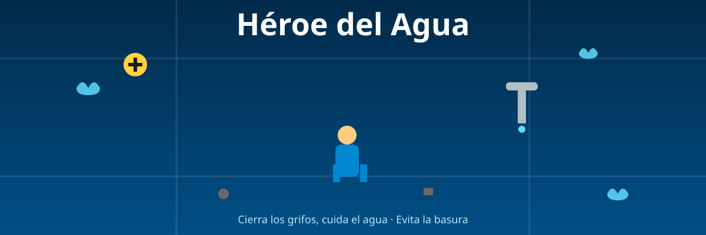
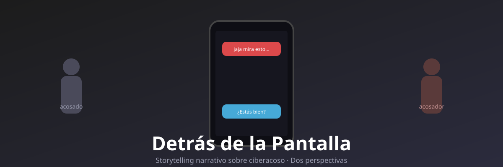
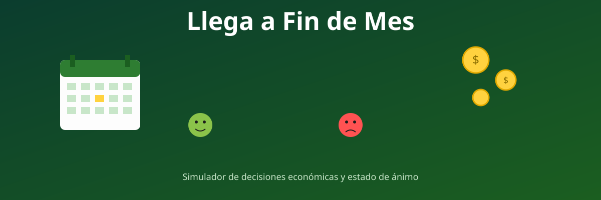

<div align="center">



<br/>


</div>

## 👋 Sobre mí

Hola, soy **Harold Abdel Carpio Santander**, estudiante de 4to semestre de **Ingeniería en Sistemas** en la **Universidad Privada del Valle (UNIVALLE)**, La Paz, Bolivia.

Me interesa el desarrollo de software y, en particular, explorar cómo la lógica de programación se combina con el diseño de juegos para crear experiencias interactivas con propósito: educación, salud, medioambiente y conciencia social.

Este repositorio reúne los primeros prototipos que desarrollé durante la asignatura *Introducción al Desarrollo de Videojuegos*. Cada proyecto nació de una pregunta simple: **¿cómo puede un juego enseñar algo mientras entretiene?**

**Intereses:** desarrollo de software, lógica de programación, game design, mecánicas de aprendizaje, narrativa interactiva.

---

## 🎮 Galería de proyectos

<table>
<tr>
<td width="50%">

<h3>🧮 mathAdventure</h3>
<p>Runner de alta velocidad estilo <em>Geometry Dash</em>: cada obstáculo es una operación matemática que debes resolver bajo presión.</p>
<b>Género:</b> Arcade / Runner<br/>
<b>Tecnología:</b> HTML5, CSS3, JavaScript<br/>
<a href="01-mathadventure/">📁 Ver proyecto</a> · <a href="https://haroldcarpio72-ai.github.io/GameHaven/01-mathadventure/">▶️ Jugar</a>
</td>
<td width="50%">

<h3>♻️ EcoCity</h3>
<p>Un pequeño animal recorre la ciudad recolectando basura y debe depositarla en el contenedor correcto antes de que se le acabe la vida.</p>
<b>Género:</b> Puzzle / Arcade<br/>
<b>Tecnología:</b> Prototipo en desarrollo (HTML5, CSS3, JavaScript)<br/>
<a href="02-ecocity/">📁 Ver proyecto</a> · <a href="https://haroldcarpio72-ai.github.io/GameHaven/02-ecocity/">▶️ Jugar</a>
</td>
</tr>
<tr>
<td width="50%">

<h3>⭐ HealthyStar</h3>
<p>Una estrella atrapada en un laberinto de visión limitada. Comer saludable mejora su aspecto y su visión; la comida chatarra la oscurece.</p>
<b>Género:</b> Puzzle / Survival<br/>
<b>Tecnología:</b> HTML5, CSS3, JavaScript<br/>
<a href="03-healthystar/">📁 Ver proyecto</a> · <a href="https://haroldcarpio72-ai.github.io/GameHaven/03-healthystar/">▶️ Jugar</a>
</td>
<td width="50%">

<h3>💧 Héroe del Agua</h3>
<p>Recorre la ciudad cerrando grifos abiertos para evitar el desperdicio de agua, esquivando la basura que resta puntos y vida.</p>
<b>Género:</b> Arcade / Acción<br/>
<b>Tecnología:</b> HTML5, CSS3, JavaScript<br/>
<a href="04-heroe-del-agua/">📁 Ver proyecto</a> · <a href="https://haroldcarpio72-ai.github.io/GameHaven/04-heroe-del-agua/">▶️ Jugar</a>
</td>
</tr>
<tr>
<td width="50%">

<h3>📱 Detrás de la Pantalla</h3>
<p>Novela interactiva sobre ciberacoso contada desde dos perspectivas: el acosado y el acosador. Tus decisiones determinan el mensaje final.</p>
<b>Género:</b> Narrativo / Storytelling<br/>
<b>Tecnología:</b> HTML5, CSS3, JavaScript<br/>
<a href="05-detras-de-la-pantalla/">📁 Ver proyecto</a> · <a href="https://haroldcarpio72-ai.github.io/GameHaven/05-detras-de-la-pantalla/">▶️ Jugar</a>
</td>
<td width="50%">

<h3>💰 Llega a Fin de Mes</h3>
<p>Simulador de decisiones económicas: administra tu dinero y tu estado de ánimo a lo largo del mes frente a imprevistos y tentaciones.</p>
<b>Género:</b> Simulación<br/>
<b>Tecnología:</b> HTML5, CSS3, JavaScript<br/>
<a href="06-llega-a-fin-de-mes/">📁 Ver proyecto</a> · <a href="https://haroldcarpio72-ai.github.io/GameHaven/06-llega-a-fin-de-mes/">▶️ Jugar</a>
</td>
</tr>
</table>

---

## 🛠️ Sobre el proceso

- **Qué aprendí:** A estructurar cada prototipo con lógica separada por archivos (HTML/CSS/JS), a manejar dificultad progresiva y sistemas de vida/puntaje, y a documentar cada proyecto de forma que alguien externo entienda rápido de qué trata.
- **Uso de IA:** Se usó apoyo de IA para redactar la documentación (README principal e individuales) y para diseñar los banners gráficos de cada juego. La lógica, mecánicas y código de los juegos fueron desarrollados por el estudiante.
- **Qué mejoraría en una próxima versión:** Agregar sonido y efectos, más niveles por juego, y guardado de progreso/puntaje en todos los prototipos.

---

## 📂 Estructura del repositorio

```
GameHaven/
├── README.md
├── assets/
├── 01-mathadventure/
├── 02-ecocity/
├── 03-healthystar/
├── 04-heroe-del-agua/
├── 05-detras-de-la-pantalla/
└── 06-llega-a-fin-de-mes/
```

<div align="center">
<sub>Portafolio creado para la asignatura Game Development — Introducción al Desarrollo de Videojuegos</sub>
</div>
